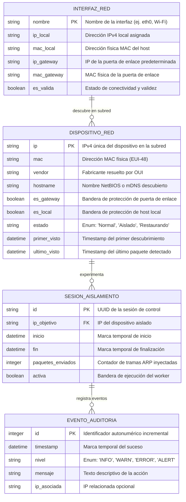
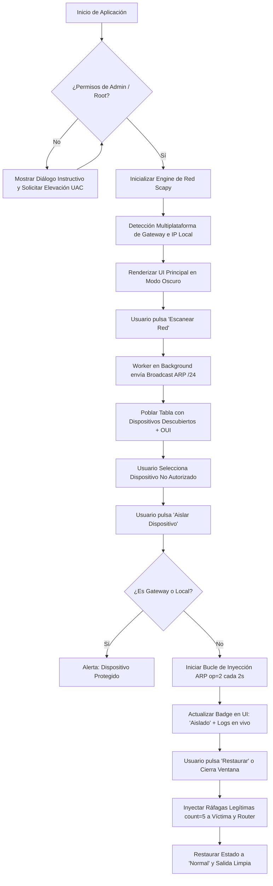

# Plano Arquitectónico Técnico: RedLocalBlock

```javascript
const RedLocalBlock_Project = {
    code: ["Python 3.11+", "CustomTkinter", "Scapy 2.5+"],
    technologies: {
        devTool: ["VSCode", "Git", "Pip", "PyInstaller"],
        network: ["Scapy", "Npcap", "Sockets Raw", "RFC 826 ARP"],
        ui: ["CustomTkinter", "Pillow", "Dark/Light Mode"],
        security: ["Clean-Room", "Admin Check (UAC/root)", "Safe Restoration", "Local-Only"]
    }
};
```

---

## 1. 🎯 Resumen Ejecutivo y Homologación Clean-Room

**RedLocalBlock** es una aplicación de escritorio moderna, segura y multiplataforma (Windows/Linux) diseñada para la auditoría, descubrimiento y control de acceso local de dispositivos en capa de enlace (Capa 2 / ARP).

El proyecto surge a partir de la ingeniería inversa del prototipo didáctico `PinguExit` (`REVERSE_ENGINEERING_REPORT.md`), rediseñando su arquitectura desde los cimientos bajo el protocolo **Clean-Room**:
* **Desacople total:** Separación estricta entre el motor de red (`NetworkEngine`), la capa de orquestación de servicios y la interfaz gráfica (`CustomTkinter`).
* **Multiplataforma real:** Eliminación de dependencias de scripts shell de Linux (`ip route`), adoptando mecanismos nativos de introspección de red de Scapy (`conf.route.route("0.0.0.0")`).
* **Garantía de Resiliencia:** Resolución del bug crítico de desconexión residual implementando rutinas atómicas de reconciliación ARP al detener, al cerrar la ventana (`WM_DELETE_WINDOW`) y en hooks de salida de emergencia (`atexit` / `signal`).
* **Descubrimiento Activo:** Evolución desde el ingreso manual de IPs hacia un escáner de subred `/24` con identificación de fabricantes por prefijo MAC (OUI).

---

## 2. 💻 Justificación del Stack Tecnológico

| Componente | Tecnología Seleccionada | Justificación Técnica | Alternativas Descartadas y Motivo |
|:---|:---|:---|:---|
| **Lenguaje Core** | **Python 3.11+** | Excelente rendimiento en manejo de hilos I/O, soporte multiplataforma nativo y madurez del ecosistema de seguridad de redes. | Go / C++ (mayor complejidad para mantenimiento de UI de escritorio) |
| **GUI Framework** | **CustomTkinter** | Proporciona estética moderna (Modo Oscuro/Claro nativo, esquinas redondeadas, escalado DPI dinámico) sin requerir binarios pesados de C++ ni licencias restrictivas. | Tkinter estándar (estética obsoleta, falta de soporte dark mode); PyQt/PySide (licencias GPL/LGPL complejas y tamaño excesivo del bundle final) |
| **Manipulación de Paquetes** | **Scapy 2.5+** | Estándar de la industria para forjado, inyección y sniffing de tramas ARP/Ethernet. Abstracción limpia de sockets raw. | Sockets RAW en C (complejidad innecesaria de compatibilidad cruzada WinPcap/Linux AF_PACKET) |
| **Resolución OUI** | **Diccionario Local Embebido** | Mapeo rápido de prefijos MAC (primeros 3 octetos) a fabricantes (Apple, Samsung, Intel, TP-Link, Espressif) sin latencia ni dependencia de red externa. | Consultas API externas (violaría privacidad local y añadiría latencia/cuotas) |
| **Control de Concurrencia** | **`threading` + `queue.Queue`** | Desacopla el bucle de paquetes del bucle de eventos de la GUI (`Tk.mainloop`), garantizando una interfaz fluida a 60 FPS sin bloqueos. | `asyncio` solo (Scapy internamente realiza llamadas síncronas bloqueantes en `send`/`srp`) |

---

## 3. 📂 Estructura de Directorios Modular

```
RedLocalBlock/
├── .gitignore                      # Exclusión blindada de secretos, caches y artefactos
├── LICENSE                         # Licencia MIT (Darwin Paz)
├── README.md                       # Documentación general y guía de instalación
├── requirements.txt                # Dependencias fijadas para producción
├── requirements-dev.txt            # Dependencias para pruebas y empaquetado
├── Project.md                      # Fuente de la verdad arquitectónica (Este archivo)
├── features.csv                    # Matriz de paridad y priorización MoSCoW
├── REVERSE_ENGINEERING_REPORT.md   # Reporte Clean-Room de ingeniería inversa
├── resumen.md                      # Análisis inicial consolidado
│
├── src/
│   ├── __init__.py
│   ├── main.py                     # Entry point, elevación UAC/root y orquestador
│   │
│   ├── core/                       # Núcleo de bajo nivel y primitivas de red
│   │   ├── __init__.py
│   │   ├── network_engine.py       # Creación e inyección de paquetes Scapy (ARP/Ether)
│   │   ├── system_detector.py      # Detección multiplataforma de Gateway, IP y MAC local
│   │   └── permissions.py          # Chequeo preventivo de privilegios Administrador/Root
│   │
│   ├── models/                     # Entidades de dominio y contratos de datos
│   │   ├── __init__.py
│   │   └── device.py               # Modelo DispositivoRed y máquina de estados
│   │
│   ├── services/                   # Capa de orquestación de casos de uso
│   │   ├── __init__.py
│   │   ├── scan_service.py         # Escaneo concurrente de subred /24 con progreso
│   │   ├── isolation_service.py    # Ciclo de vida de aislamiento y restauración atómica
│   │   └── oui_service.py          # Identificador de fabricante a partir de MAC OUI
│   │
│   ├── ui/                         # Interfaz gráfica moderna (CustomTkinter)
│   │   ├── __init__.py
│   │   ├── app.py                  # Ventana principal, layout maestro y despachador
│   │   ├── theme.py                # Paleta de colores, tokens visuales y tipografías
│   │   └── components/             # Widgets modulares reutilizables
│   │       ├── __init__.py
│   │       ├── header_bar.py       # Indicadores de interfaz activa, Gateway e IP local
│   │       ├── device_table.py     # Tabla interactiva con selección y badges de estado
│   │       ├── control_panel.py    # Botones Escanear, Aislar, Restaurar Todo
│   │       ├── log_console.py      # Consola de auditoría con marcas de tiempo
│   │       └── status_bar.py       # Resumen de dispositivos encontrados y estado actual
│   │
│   └── utils/                      # Utilidades transversales
│       ├── __init__.py
│       └── logger.py               # Logger thread-safe conectado a Queue de la UI
│
└── tests/                          # Batería de pruebas unitarias
    ├── __init__.py
    ├── test_permissions.py         # Validación de detección de privilegios
    ├── test_device_model.py        # Pruebas de máquina de estados del dispositivo
    └── test_oui_service.py         # Pruebas de resolución de prefijos MAC
```

---

## 4. 🗄️ Modelo de Datos e Integridad con Concurrencia (ERD)



### Reglas de Integridad y Restricciones Anti-Colisión:
1. **Invariante de Protección de Infraestructura (Anti-DoS accidental):**
   * Queda estrictamente prohibido iniciar una sesión de aislamiento sobre un registro donde `es_gateway == True` o `es_local == True`. La capa de servicio rechaza la operación inmediatamente (`ActionForbiddenError`).
2. **Atomicidad de Estado en Transición:**
   * La lista de dispositivos se protege con un `threading.RLock()` reentrante. Si un dispositivo está en estado `'Aislado'`, no puede iniciarse una segunda sesión concurrente sobre la misma IP (idempotencia estricta).
3. **Garantía de Reconciliación Transaccional:**
   * Si una sesión activa pasa a `activa = False`, el hilo está obligado a completar el envío de la ráfaga de restauración (`count=5`) antes de transicionar el estado del dispositivo de `'Restaurando'` a `'Normal'`.

---

## 5. 🔄 Flujos de Usuario y Orden de Construcción por Core Loop



### Orden de Desarrollo por Core Loop (Fases Priorizadas):

* **Fase 1: Core Loop de Red y Seguridad (P0 - Crítico)**
  1. Módulo `permissions.py`: Verificación de UAC / root y dependencias de captura Npcap.
  2. Módulo `system_detector.py`: Resolución multiplataforma de interfaz, gateway y MAC local.
  3. Módulo `network_engine.py`: Funciones atómicas de forjado ARP (`op=1`, `op=2`) y reconciliación legítima.
  4. Módulo `isolation_service.py`: Gestión del bucle asíncrono con restauración garantizada ante cualquier señal de parada.

* **Fase 2: Motor de Descubrimiento e Interfaz Moderna (P1 - Alta Prioridad)**
  1. Módulo `scan_service.py`: Barrido ARP de la subred local (`/24`) sin bloquear la interfaz.
  2. Módulo `oui_service.py`: Diccionario estático para enriquecer la tabla con fabricantes.
  3. Módulo `ui/app.py` & `device_table.py`: Ventana en CustomTkinter con tabla interactiva, badges y selección con un clic.
  4. Módulo `log_console.py`: Despacho de logs thread-safe mediante cola de mensajes.

* **Fase 3: Robustez, Usabilidad y Empaquetado (P2 - Pulido Final)**
  1. Atrapado del evento `WM_DELETE_WINDOW` y manejadores de señales `SIGINT` / `SIGTERM` para garantizar cierre limpio.
  2. Filtro de búsqueda y ordenamiento de columnas en la tabla de dispositivos.
  3. Exportación de auditoría en formato CSV.
  4. Empaquetado portable con PyInstaller para Windows (`RedLocalBlock.exe`).

---

## 6. 🛡️ Cumplimiento Normativo y Seguridad por Diseño

### A. Marco Legal y Privacidad (DSGVO / GDPR y TDDDG)
1. **Operación 100% Local (Local-First):** La aplicación no envía telemetría, direcciones MAC ni metadatos de red a ningún servidor externo o servicio en la nube.
2. **Finalidad Estrictamente Defensiva y de Auditoría:** Diseñada para administración de redes privadas y control de intrusos bajo autorización del propietario de la red.
3. **Sin Interceptación de Contenidos (No MITM Payload Sniffing):** La herramienta no realiza inspección profunda de paquetes (DPI) ni captura contraseñas, URLs o contenidos que violen el secreto de las telecomunicaciones (TDDDG § 3 / DSGVO Art. 5).
4. **Localhost Binding:** Para cualquier servicio o socket auxiliar interno, el binding es estrictamente `127.0.0.1`, prohibiendo exposición en `0.0.0.0`.

### B. Blindaje contra Fuga de Datos
* **`.gitignore` Armado:** Exclusión automática de credenciales, certificados, llaves privadas y logs de auditoría interna.
* **Sin Hardcoding:** Cero credenciales o rutas absolutas quemadas en código fuente.

### C. Estrategia de Cadena de Suministro Segura
* Fijación estricta de versiones de dependencias en `requirements.txt`:
  ```text
  scapy==2.5.0
  customtkinter==5.2.2
  pillow==10.4.0
  ```

---

## 7. 📱 Diseño Adaptable y Ergonomía de Escritorio (Desktop UX)

* **Layout Maestro:**
  * **Barra Superior (Header):** Información fija del entorno (Tarjeta de red activa, IP local, Gateway detectado).
  * **Cuerpo Principal (Split Horizontal):**
    * **Panel Izquierdo / Central (70%):** Tabla interactiva de dispositivos con cabeceras ordenables, scroll fluido y badges de estado con código de color (Verde: Normal, Rojo: Aislado, Ámbar: Protegido).
    * **Panel Lateral de Control (30%):** Botones de acción prominentes (`Escanear Red`, `Aislar Seleccionado`, `Restaurar Seleccionado`, `Restaurar Todo`), toggle de Modo Oscuro/Claro e indicador de actividad.
  * **Panel Inferior Colapsable:** Consola de auditoría con marcas de tiempo `[HH:MM:SS]` y botón para limpiar registros.
* **Escalado DPI:** Compatibilidad nativa con pantallas HiDPI / 4K gracias al motor de escalado vectorial de CustomTkinter.

---

## 8. ⚠️ Matriz de Riesgos Técnicos y Mitigaciones

| # | Riesgo Técnico Crítico | Severidad | Mitigación Arquitectónica Implementada |
|:---|:---|:---:|:---|
| **R-1** | **Víctima queda sin Internet tras detener la app o por crash** | **Alta (S1)** | Registro triple de seguridad: (1) Invocación de `restaurar_conexion()` en `detener()`; (2) Interceptación obligatoria del cierre de ventana `WM_DELETE_WINDOW`; (3) Hook de salida del sistema `atexit.register()` y `signal.signal(SIGINT)` enviando 5 paquetes ARP de reconciliación legítima antes de terminar el proceso. |
| **R-2** | **Congelamiento de la GUI o fallos gráficos por llamadas directas de Scapy** | **Media (S2)** | Desacople completo mediante arquitectura basada en colas (`queue.Queue`). El worker de red nunca toca widgets de CustomTkinter; sólo encola eventos que el hilo principal procesa mediante `app.after(100, procesar_cola)`. |
| **R-3** | **Fallo de inicio por ausencia de privilegios de Administrador o Npcap en Windows** | **Alta (S1)** | Verificación preventiva en `src/core/permissions.py` usando `ctypes.windll.shell32.IsUserAnAdmin()`. Si no tiene permisos, relanza automáticamente el proceso solicitando elevación UAC (`runas`), y si Npcap no está presente, muestra un modal con enlace de descarga guiada. |

---

## 9. 🎖️ Dictamen Arquitectónico (Visto Bueno)

> **CERTIFICACIÓN DE VISTO BUENO ARQUITECTÓNICO:**  
> El presente plano técnico satisface íntegramente los estándares de seguridad por diseño, resiliencia de red, compatibilidad multiplataforma y cumplimiento normativo.  
> Los requerimientos levantados en `features.csv` y `REVERSE_ENGINEERING_REPORT.md` han sido completamente asimilados y estructurados.  
> **Estado:** **APROBADO PARA CONSTRUCCIÓN** (`02b-el-constructor`).
