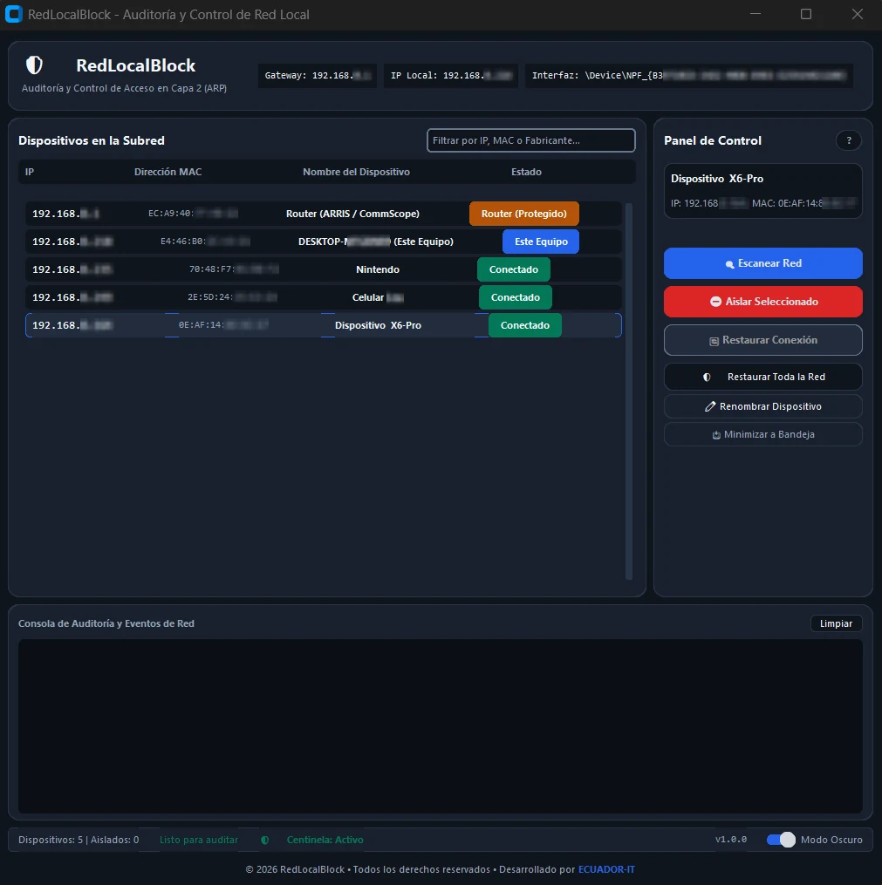

# RedLocalBlock 🛡️

**Modern Layer-2 (ARP) Local Network Discovery, Auditing, and Access Control Tool.**  
Built with Python, **CustomTkinter**, and **Scapy** under a Clean-Room software architecture.

<p align="center">
  <strong>Language:</strong>
  <a href="README.md">Español</a> |
  <a href="README.en.md">English</a> |
  <a href="README.de.md">Deutsch</a>
</p>

<p align="center">
  <a href="./Project.md"></a>
</p>

<p align="center">
  
</p>

---

## 🚀 Key Features

* **Modern Graphical User Interface (CustomTkinter):**
  * Modern Dark Mode (Cyberpunk / Terminal) and accessible Light Mode compliant with WCAG 2.1 AA/AAA contrast ratios.
  * Live Light/Dark theme switcher seamlessly updating all cards, tables, and audit logs.
  * Automatic scaling for HiDPI and 4K displays.
* **Active Subnet Discovery (/24) & Smart Hardware Identification:**
  * Asynchronous subnet sweeps via ARP without blocking or freezing the UI thread.
  * Local MAC OUI vendor resolution (Apple, Samsung, Intel, TP-Link, Espressif, Nintendo, Sony, ARRIS, etc.).
  * Friendly device naming with persistent custom nicknames ("✏️ Rename Device") saved locally in `device_aliases.json`.
* **🛡️ Sentinel Mode (Passive Sniffing) & System Tray Integration:**
  * Passive Layer-2 listening (0 network overhead / 0 bytes transmitted) detecting when any new or unknown device connects and broadcasts ARP Announcements / Probes (RFC 5227).
  * Native Windows Toast / Balloon alerts displaying IP, MAC address, and vendor.
  * Silent background execution next to the system clock with a context menu (`Show`, `Sentinel Mode`, `Scan Now`, `Restore All`, `Exit`).
* **Controlled Layer-2 Isolation:**
  * Selective disconnection of unauthorized nodes via targeted ARP reply spoofing (`op=2`).
  * Anti-self-lockout protection: Default Gateway and host machine are strictly shielded against isolation.
* **Guaranteed Atomic Reconciliation & Recovery:**
  * Instant ARP routing restoration when clicking "Restore" (burst of 5 legitimate ARP frames).
  * Emergency triggers on system exit hooks (`atexit`) and on window close (`WM_DELETE_WINDOW`).
* **Interactive Expandable User Manual (Accordion Modal):**
  * Modal dialog accessible via the `📖 Manual` button with collapsible step-by-step guidance.
* **Standard Agency Footer:**
  * Footer with dynamic year and attribution linked to development agency **[ECUADOR-IT](https://www.ecuador-it.com/)**.
* **Cross-Platform Compatibility (Windows / Linux):**
  * Native default gateway and local IP resolution without depending on Linux shell commands.
  * Preventive elevation checks: Windows UAC dialogs and Linux root (`sudo`).
* **Privacy & Security by Design (GDPR / DSGVO / TDDDG):**
  * 100% *Local-First* operation: no telemetry, no cookies, no external cloud dependencies.
  * System-native fonts without third-party CDN requests.
  * Zero payload inspection: strictly administrative L2 control without packet payload sniffing (no MitM).

---

## 📋 System Requirements

* **Python 3.11+**
* **Windows:**
  * Requires **[Npcap 1.90 installer](https://npcap.com/dist/npcap-1.90.exe)** for Layer-2 packet manipulation.
  * *Important during setup:* Check the box **`Install Npcap in WinPcap API-compatible Mode`**.
  * Administrator privileges (the launcher triggers UAC elevation automatically).
* **Linux:** Requires superuser privileges (`sudo`).

---

## 🛠️ Installation

1. **Clone or download the repository:**
   ```bash
   git clone https://github.com/dwn10/RedLocalBlock.git
   cd RedLocalBlock
   ```

2. **Create and activate a virtual environment (recommended):**
   ```bash
   python -m venv venv
   # On Windows:
   .\venv\Scripts\activate
   # On Linux:
   source venv/bin/activate
   ```

3. **Install dependencies:**
   ```bash
   pip install -r requirements.txt
   ```

---

## 💻 Usage

### On Windows (Three Available Options):

#### 🚀 Option 1: 1-Click Launcher (`Iniciar.bat` - Recommended)
* **Double-click** on `Iniciar.bat`.
* **Advantages:** Instant startup (<0.5s), runs silently with `pythonw.exe` without dark console windows, and prompts for Windows UAC elevation automatically.

#### 📦 Option 2: Portable Compilation and Execution (`.exe`)
To create a standalone portable executable without invoking Python:
1. Double-click on `compilar_exe.bat` (or execute `.\compilar_exe.bat` in terminal).
2. The standalone binary is generated at `dist/RedLocalBlock.exe` bundling all dependencies (`customtkinter`, `scapy`, `pystray`, etc.).
3. **Run:** Double-click on `dist/RedLocalBlock.exe` and accept the Windows UAC administrator prompt.
> *Note:* Target PCs must have the **Npcap** capture driver installed.

#### 🛠️ Option 3: Terminal / Developer Mode
Run terminal as **Administrator** (or allow automatic UAC elevation):
```bash
python -m src.main
```

### On Linux:
Run with superuser privileges:
```bash
sudo python -m src.main
```

---

## 🧪 Automated Unit Testing

To verify network engines, device state machines, OUI resolution, modal dialogs, sentinel monitoring, and system tray:
```bash
python -m unittest discover tests
```

---

## 📂 Project Structure

```
RedLocalBlock/
├── src/
│   ├── main.py                     # Entry point and UAC/root privilege elevation
│   ├── core/                       # Scapy engine, network detector, and permissions
│   │   ├── network_engine.py       # Scapy packet crafting & injection (ARP/Ethernet)
│   │   ├── system_detector.py      # Cross-platform Gateway, IP, and MAC discovery
│   │   └── permissions.py          # Preventive Administrator/Root privilege checks
│   ├── models/                     # Device entity and lifecycle state machine
│   │   └── device.py               # DispositivoRed model and friendly name resolution
│   ├── services/                   # Network services, aliases, and OUI lookups
│   │   ├── scan_service.py         # Concurrent /24 subnet discovery with progress
│   │   ├── sentinel_service.py     # Passive Layer-2 listening & intruder detection (RFC 5227)
│   │   ├── isolation_service.py    # Isolation lifecycle and atomic ARP reconciliation
│   │   ├── oui_service.py          # Hardware vendor lookup by MAC OUI prefix
│   │   └── alias_service.py        # Local persistent device nickname storage in JSON
│   ├── ui/                         # CustomTkinter GUI, theme, and components
│   │   ├── app.py                  # Main window layout, dispatcher, and event loop
│   │   ├── theme.py                # WCAG 2.1 color palette (Dark/Light mode)
│   │   └── components/             # Reusable UI components
│   │       ├── header_bar.py       # Interface info pills and Manual modal button
│   │       ├── device_table.py     # Interactive table with live search and state badges
│   │       ├── control_panel.py    # Action buttons: Scan, Isolate, Restore, Rename, Tray
│   │       ├── log_console.py      # Real-time event log console with timestamps
│   │       ├── status_bar.py       # Metrics, theme toggle, and Sentinel status badge
│   │       ├── manual_modal.py     # Interactive accordion user guide popup
│   │       ├── footer.py           # Standard agency footer with ECUADOR-IT credits
│   │       └── tray_manager.py     # System Tray icon and native Windows Toast alerts
│   └── utils/                      # Cross-cutting utilities
│       └── logger.py               # Thread-safe logger piped to UI queue
├── tests/                          # 25 automated unit tests suite
│   ├── test_device_model.py        # State machine and friendly name tests
│   ├── test_footer.py              # Footer component unit tests
│   ├── test_manual_modal.py        # Accordion modal sections tests
│   ├── test_network_engine.py      # ARP frame crafting unit tests
│   ├── test_oui_service.py         # MAC vendor resolution tests
│   ├── test_permissions.py         # System permission check tests
│   ├── test_sentinel_service.py    # Passive sniffing and intruder alert tests
│   └── test_tray_manager.py        # System tray and icon rendering tests
├── device_aliases.json             # Persistent local JSON storage for device nicknames
├── Iniciar.bat                     # Silent 1-click Windows launcher with auto-UAC
├── compilar_exe.bat                # Standalone PyInstaller packaging script
├── Branding.md                     # Visual design identity and WCAG accessibility guide
├── Project.md                      # System architectural blueprint
├── TODO.md                         # Project roadmap and milestones tracker
├── tokens.json                     # Semantic design tokens verified with contrast.py
└── requirements.txt                # Production pinned dependencies
```

---

## ⚖️ License & Ethical Use

Distributed under the **MIT License**.  
This tool was created strictly for **educational, defensive, and local network administration purposes**. Its use is restricted to networks owned or explicitly authorized by the user.

<br>
<p align="center">
  <a href="./Project.md"></a>
</p>

---
<br>
<p align="center">
  <small>All rights reserved © 2026 | <a href="https://github.com/dwn10">Darwin Paz</a></small>
</p>
